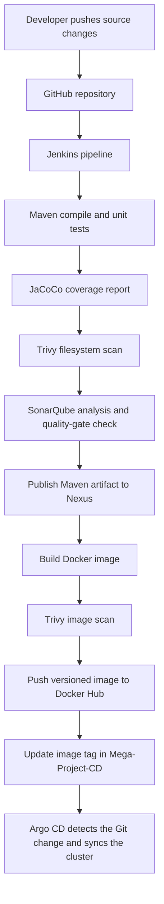

# BankApp – Continuous Integration (CI)

This repository contains the Java 17 / Spring Boot source code and the Jenkins pipeline used to build, test, scan, package, and publish the BankApp application.

The main goal of this repository is to automate the Continuous Integration part of the delivery workflow. After a successful image build and push, the pipeline updates the image tag in the separate deployment repository, [`Mega-Project-CD`](https://github.com/SurajKhanderao/Mega-Project-CD).

## Project at a glance

- Application: Java 17 and Spring Boot BankApp
- Build tool: Maven
- CI automation: Jenkins Declarative Pipeline
- Code quality: SonarQube and JaCoCo
- Security scanning: Trivy filesystem and container-image scans
- Artifact repository: Nexus Repository
- Container registry: Docker Hub
- Deployment hand-off: Git commit that updates the image tag in the CD repository

## CI workflow



The pipeline uses the Jenkins build number to create image tags in the form `v<BUILD_NUMBER>`. The image name configured in the Jenkinsfile is `surajkhanderao/bankapp`.

## Pipeline stages

| Stage | What it does |
|---|---|
| Checkout | Checks out the `main` branch from this GitHub repository. |
| Compile | Compiles the Java application with Maven. |
| Testing | Runs Maven tests and generates/uses the JaCoCo coverage report. |
| Trivy File Scanning | Scans the source workspace and writes `fs-report.txt`. |
| SonarQube Analysis | Analyses application source and test code, using the JaCoCo XML report. |
| Quality Gate | Waits for the SonarQube quality-gate result. The current Jenkinsfile sets `abortPipeline: false`, so a failed gate does not automatically stop the pipeline. |
| Deploy to Nexus | Runs `mvn deploy` using the configured Maven settings for Nexus. |
| Build the Image | Builds the Docker image using the repository Dockerfile. |
| Image Scanning | Scans the newly built image with Trivy and writes `image-report.txt`. |
| Push the Image | Pushes the versioned image to Docker Hub. |
| Update Manifest File | Clones the CD repository, updates the image tag in `Manifests/bankapp-deploy.yml`, commits the change, and pushes it to `main`. |

> Note: The current Trivy commands generate scan reports. They do not specify a severity threshold or `--exit-code`, so the scans should be treated as reporting steps rather than guaranteed vulnerability-based pipeline blockers. Configure an explicit policy if you want findings to fail the build.

## Repository structure

```text
Mega-Project-CI-main/
├── .mvn/
│   └── wrapper/
├── manifests/          # Kubernetes manifest files kept with the application source
├── src/
│   ├── main/           # Application source code
│   └── test/           # Test source code
├── .gitignore
├── Dockerfile          # Multi-stage Java build and runtime image
├── Jenkinsfile         # CI pipeline definition
├── mvnw                # Maven Wrapper for Linux/macOS
├── mvnw.cmd            # Maven Wrapper for Windows
└── pom.xml             # Maven dependencies and build configuration
```

## Technology stack

- Java 17
- Spring Boot
- Maven and Maven Wrapper
- Jenkins Declarative Pipeline
- SonarQube
- JaCoCo
- Trivy
- Docker (multi-stage build)
- Docker Hub
- Nexus Repository
- Git and GitHub

## Run the application locally

### Prerequisites

- JDK 17
- Git
- Docker (optional, for container execution)

### Clone and build

```bash
git clone https://github.com/SurajKhanderao/Mega-Project-CI-main.git
cd Mega-Project-CI-main

# Compile and run tests using the Maven Wrapper
./mvnw clean test

# Package the application
./mvnw clean package
```

On Windows, use `mvnw.cmd` instead of `./mvnw`.

The generated JAR is normally placed under `target/`. Start it with:

```bash
java -jar target/<generated-jar-name>.jar
```

The Dockerfile builds the application with Maven/JDK 17 and uses a Java 17 JRE Alpine image for the runtime stage. The container exposes port `8080`.

```bash
docker build -t bankapp:local .
docker run --rm -p 8080:8080 bankapp:local
```

The application may require database and other environment configuration. Supply the values required by the project before starting it; do not commit credentials to the repository.

## Jenkins configuration

Create/configure the following Jenkins tools, integrations, and credentials to match the identifiers referenced by the current `Jenkinsfile`:

| Jenkins item | Identifier used by the pipeline | Purpose |
|---|---|---|
| JDK installation | `jdk17` | Java 17 build environment |
| SonarQube Scanner tool | `sonar-scanner` | Runs SonarQube analysis |
| SonarQube server configuration | `sonar-server` | Provides the SonarQube server connection |
| SonarQube token credential | `sonar-token` | Used by the quality-gate wait step |
| Maven settings configuration | `nexus-secrets` | Provides Nexus repository configuration/credentials |
| Docker registry credential | `docker-hub-cred` | Authenticates to Docker Hub |
| Git username/password credential | `git-cred` | Pushes the updated manifest to the CD repository |

The Jenkins agent also needs the required tools and plugins, including Maven integration, Docker Pipeline, SonarQube Scanner integration, Credentials Binding, Git, and Pipeline Utility/related steps used by your Jenkins installation. Ensure Docker, Maven, Trivy, Git, and the required JDK are available to the agent.

### Important credential notes

- Use Jenkins Credentials; never place passwords, access tokens, or registry credentials directly in the Jenkinsfile.
- The Git credential must have permission to push commits to `Mega-Project-CD`.
- The Docker Hub credential must be able to push to `surajkhanderao/bankapp`.
- Configure the Nexus server and repository details in the Jenkins Maven settings.
- The CI pipeline currently commits the image-tag update to the `main` branch of the CD repository.

## How CI connects to CD

After pushing the new image, the pipeline clones `Mega-Project-CD`, changes the image reference in `Manifests/bankapp-deploy.yml` to the newly generated tag, and pushes the commit. The CD repository is then the source of truth for the Kubernetes deployment configuration. Argo CD can detect the Git change and synchronize the updated manifest to the target Kubernetes cluster when its Application is configured to watch that repository and path.

See the [Mega-Project-CD repository](https://github.com/SurajKhanderao/Mega-Project-CD) for Kubernetes manifests, RBAC resources, and the deployment pipeline.

## Troubleshooting tips

- **Maven build fails:** Check that JDK 17 is selected and that Maven dependencies can be downloaded.
- **SonarQube stage fails:** Verify the `sonar-server` configuration, scanner installation, token, project permissions, and JaCoCo report path.
- **Nexus publish fails:** Check the `nexus-secrets` Maven settings and repository deployment permissions.
- **Docker push fails:** Verify `docker-hub-cred`, image repository permissions, and Docker access on the Jenkins agent.
- **Manifest update fails:** Verify `git-cred` has write access and that `Manifests/bankapp-deploy.yml` exists in the CD repository.
- **Deployment does not change:** Check that the new image tag was committed to the CD repository and that the Argo CD Application watches the correct repository, branch, and manifest path.

## Related repository

- [Mega-Project-CD – Kubernetes deployment and GitOps repository](https://github.com/SurajKhanderao/Mega-Project-CD)

---

This repository demonstrates a hands-on CI workflow for a Java/Spring Boot application. Review the Jenkins configuration and environment-specific values before using it in another environment.
